# Okta for AI Agents + Amazon Bedrock Agent (Classic) + Okta Agent Gateway + GitHub MCP

A demo of a signed-in user asking an **Amazon Bedrock Agent (Classic)** questions about their GitHub repositories, where every tool call runs **as that user** through the **Okta Agent Gateway**. The Bedrock agent, the Lambda and the front-end app never hold a GitHub credential.

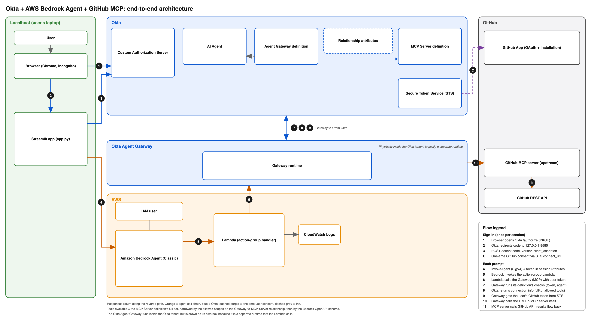

## Overview

1. A small **Streamlit app** on the user's machine signs the user in with Okta (OIDC authorization code + PKCE). It uses the client identity of an **Okta AI Agent** and authenticates with a signed JWT (`private_key_jwt`). The tokens come from the **custom authorization server** that the Agent Gateway trusts.
2. The app calls the **Bedrock agent** using AWS IAM credentials. The prompt goes in the request, and the user's Okta **access token** goes in `sessionAttributes`.
3. The Bedrock agent is a shell: a model plus an **action group** with an OpenAPI schema describing the GitHub tools. It knows nothing about Okta.
4. When the model picks a tool, Bedrock invokes a **Lambda function**. The Lambda reads the access token from the session attributes and makes the tool call to the **Okta Agent Gateway** over MCP, sending the token as a bearer token. It doesn't know about specific tools and just passes the call through.
5. The **Agent Gateway** validates the token and the agent, checks the tool is allowed for the MCP Server it is connected to, and looks up the user's stored GitHub credentials. GitHub is an OAuth (STS) connection, so the first call returns a `connect_url` for one-time user consent. It then calls the **GitHub MCP server** itself and passes the result back to the Lambda, and on to the agent and the user.

Result: the user's identity is carried end to end (the token holds the user in `sub` and the agent in `cid` and `act`), GitHub access is brokered by Okta, and access can be changed in Okta without touching AWS or GitHub.

For the fuller picture, including the Okta objects (AI Agent, Gateway definition, MCP Server definition and the authorization server), see [docs/architecture-with-mcp-definition.png](docs/architecture-with-mcp-definition.png) and the slide deck in this repo.

## Design decisions

- **A solution, not necessarily the best one.** This demo shows how the Okta Agent Gateway and a downstream MCP server can be called from AWS Bedrock with minimal alteration to the agent and the AWS platform. Other approaches are possible.
- **Token handling is deliberately incomplete.** The demo does not process the `connect_url` returned by the OAuth (STS) flow when the user has no grant yet, and it does not refresh the user's session with Okta. Production code would need both.
- **A limited set of GitHub tools is exposed on purpose.** Only a few tool calls are defined in the agent's OpenAPI schema. To give the agent more, add the tools and their arguments to the schema in the agent definition. The Okta settings only need to change if the MCP vendor updates its tool list or you want Gateway users to have a different list.
- **The Lambda is stateless.** It repeats the MCP handshake (`initialize`, `notifications/initialized`) on every call instead of caching a session. This keeps it simple and robust, at the cost of two extra round trips per tool call.
- **Gateway errors are shown in the chat.** The Gateway returns errors as HTTP 200 (a JSON-RPC `error`, or a result with `isError`). The Lambda passes these back as normal responses so the agent can show the real message. A non-2xx response would make Bedrock raise `dependencyFailedException` and hide the cause. The trade-off is that failures look like ordinary replies.
- **No Okta or GitHub secrets live in AWS.** The Lambda only forwards the user's access token, and the Gateway does the exchange for the GitHub token. The one secret in the demo is the AI Agent's private key, which stays with the front-end app.
- **The front end signs in as the AI Agent.** The app uses the agent's own client ID and `private_key_jwt`, so the tokens carry the agent as `cid`. Signing in with a separate application would fail the Gateway's agent-link check.
- **The front end runs locally.** The app receives the OAuth redirect on `127.0.0.1:8585`. A hosted version would need a registered callback URL and a server-side session.
- **GitHub access is read-only.** The GitHub App only has read-only permissions, so GitHub refuses any update whichever tools are exposed. The tool list is also narrowed in three places: the MCP Server definition holds the full set, the Gateway's selection leaves out most update tools (29 of 46 here), and the agent's schema exposes only a few read tools.
- **One Bedrock session ID per conversation.** It keeps the conversation context. Session IDs must never be shared between users.
- **No tool discovery.** The schema is maintained by hand and the Lambda never calls `tools/list`. This keeps the code simple, with schema drift as the cost if the vendor changes its tools.

## Considerations for O4AA / Agent Gateway with Bedrock

*Summarised from the slide deck `O4AA-AWSBedrockClassic-AgentGW-demo.pdf` (slides 4 to 7).*

**Bedrock Agents (Classic) cannot call MCP services**
- Their only tool mechanism is an action group (a Lambda function or return-of-control), so a Lambda is needed to make tool calls to an external MCP server.
- Putting the AWS Bedrock AgentCore Gateway in the path adds a hop with no benefit when the Okta Agent Gateway is already the MCP front door.
- Calling an AgentCore Gateway needs AgentCore agents (plus a Lambda for any token exchange if the Okta Agent Gateway isn't used).

**Bedrock Agents (Classic) and AgentCore environments are serverless**
- Classic can't host a redirect URI or hold interactive state, and AgentCore can't interact with the user directly. They act only as the "backend" that orchestrates the model and services.
- An external **frontend app** is needed. Here the local app owns sign-in and the callback, and the Lambda is stateless (it re-initialises the MCP session on every call).
- With only agents in Bedrock/AgentCore, the default model is machine to machine.

**Differences between Bedrock Agents (Classic) and AgentCore for Okta imports**
- Both can be imported as agent definitions, and Okta's current docs list both with resource connection support.
- The import is a read-only inventory (it uses `bedrock:GetAgent` and `bedrock:ListAgents`) that records the agent for governance. It does not discover connections from AWS.
- Resource connections are Okta objects attached to the Okta AI Agent, not found in Bedrock. With Classic, the governed connection attaches to the agent identity that signs in (the linked app), not to the Bedrock agent resource. The Bedrock agent is effectively a runtime for the Lambda.

**Tool definitions are static**
- The agent only knows the tools in the action group's OpenAPI schema. It does not discover MCP tools.

**Bedrock has no mechanism to pass Okta identity to other services**
- Classic `InvokeAgent` authenticates with IAM only, so the user's identity has to travel as data.
- AgentCore Runtime differs: it can accept an Okta JWT as inbound auth, but its outbound tool calls then run as the agent's own principal, which breaks attribution.

**Two authorization layers and two audit trails**
- IAM decides who can invoke the agent (app level). Okta decides what is done for which user (at the Gateway). Neither enforces the other.
- CloudTrail shows the IAM user. The Okta System Log shows the user and the agent.

**Other considerations**
- **Token handling:** the bearer token rides through the Bedrock session and the Lambda, so keep it out of logs and traces. It is short-lived and there is no refresh path in the agent, so the frontend must handle expiry.
- **Consent has to be surfaced:** when the Gateway returns a `connect_url`, something must relay it to the user. Design the Lambda and frontend for that response.
- **Error handling:** the Gateway returns errors as HTTP 200. A non-2xx response from the Lambda becomes `dependencyFailedException` and hides the cause, so the Lambda has to translate errors into normal responses.
- **Session IDs:** use one per user and conversation, never shared between users.

**Minimum change to add O4AA to an AWS agent**
- An external frontend app performs user authentication (OAuth + PKCE).
- The app calls the Bedrock agent with AWS IAM credentials and passes the Okta access token in `sessionAttributes`.
  - The agent's action-group schema defines the downstream MCP tools and arguments, and has nothing defined for the Okta Agent Gateway or other Okta objects.
  - The agent isn't coded to make token exchange calls with Okta or any other IdP.
- A bespoke Lambda makes the tool calls to the Okta Agent Gateway. It consumes the access token from `sessionAttributes`, knows how to construct the Gateway call and process the response, and doesn't need to know specific tools unless you make it a router for multiple gateways.
- **Security benefit:** no Okta or GitHub secrets live in AWS. The Lambda forwards the user's token and the Gateway does the exchange.

## Files in this repository

| File | Purpose |
|---|---|
| `README.md` | This file |
| `app.py` | Streamlit front-end: PKCE sign-in as the Okta AI Agent (`private_key_jwt`), chat UI, Bedrock `InvokeAgent` call with the token in `sessionAttributes`, and a panel showing the decoded ID and access tokens |
| `lambda_function.py` | Bedrock action-group Lambda: reads the access token and makes the MCP calls (`initialize`, then `tools/call`) to the Okta Agent Gateway. Standard library only |
| `openapi_schema.json` | Action-group OpenAPI schema describing the GitHub tools the agent can use |
| `start.sh` | Sets the environment variables (placeholders to fill in) and starts the app |
| `stop.sh` | Stops the app |
| `docs/architecture-simple.png` | Simplified architecture diagram (shown above) |
| `docs/architecture-with-mcp-definition.png` | Detailed architecture diagram including the Okta MCP Server definition and the Gateway-to-MCP-Server relationship |
| `O4AA-AWSBedrockClassic-AgentGW-demo.pdf` | Slide deck: architecture, considerations, Okta components and authentication/authorization flows |
| `.gitignore` | Keeps the agent's private key and runtime files out of the repo |

All environment-specific values have been replaced with placeholders.

## Using the files

- **`start.sh`:** fill in your Okta org domain, the custom authorization server ID, the AI Agent's client ID, the Bedrock agent ID and alias, and the AWS region. `OKTA_PRIVATE_KEY_FILE` points to the AI Agent's private JWK (`agent_key.json`), which is **not** included and must never be committed.
- **Python:** the app needs `streamlit`, `boto3`, `requests`, `PyJWT` and `cryptography`. AWS credentials with `bedrock:InvokeAgent` on the agent alias must be available to `boto3`. Sign-in opens a Chrome window on macOS and falls back to the default browser elsewhere.
- **Lambda:** set `OKTA_AGENT_GATEWAY_URL` to the Agent Gateway's MCP endpoint, and `TOOL_PREFIX` if the Gateway prefixes tool names (check with an MCP `tools/list` call). Use a timeout of 30 seconds or more, and return errors as normal responses (see the considerations above).
- **Okta and GitHub:** the AI Agent, custom authorization server, Agent Gateway, MCP Server definition and the GitHub connection (a GitHub App with the permissions you want to expose) are configured in Okta and GitHub. The slide deck summarises the objects and flows.

## Okta/O4AA Components

There are multiple components in Okta to be configured as shown in the following figure.

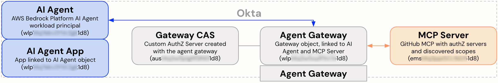

These are covered in the following sections.

### AI Agent
A new AI Agent was created with a new linked app created automatically. It represents the Bedrock platform instance, not specific agents running in there.

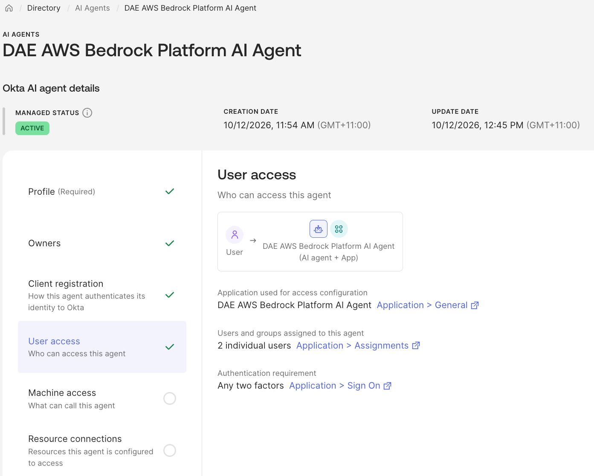

The AI Agent has the usual profile and owners settings. The client registration was set to public/private key, but the choice depends on your frontend app and hosting environment.\
The user access app will be used to anchor the Okta user to the agent calling the gateway.\
There is no machine access defined for this agent.\
There are no resource connections as these will be mapped to the gateway.

### AI Agent App
The linked app was created with the AI Agent and is linked to that agent.

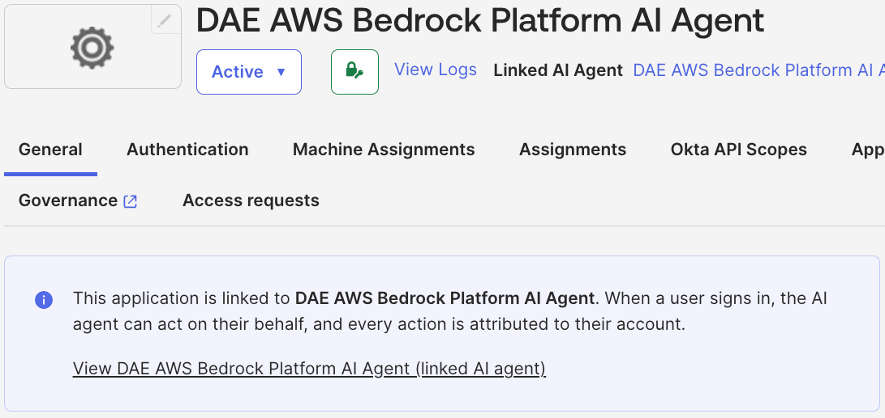

The app is a normal OIDC Web app with the Authorisation Code grant.

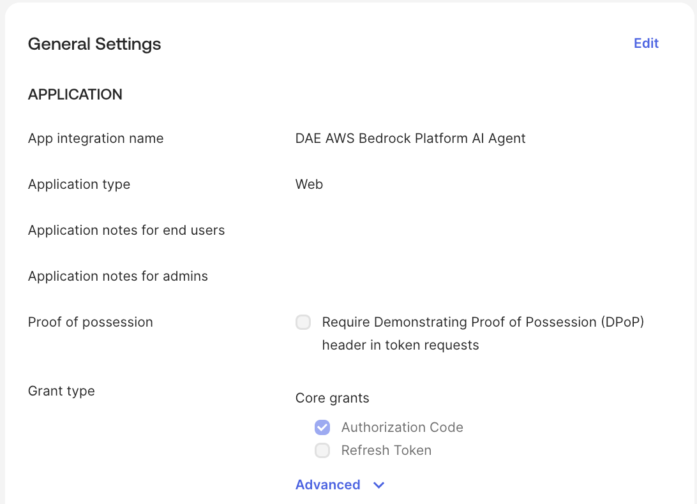

The app definition includes the sign-in redirect URI to a port on localhost that the frontend app is listening to so it can receive the authorisation code. It’s also highlighting that the user access for the agent is linked to the agent.

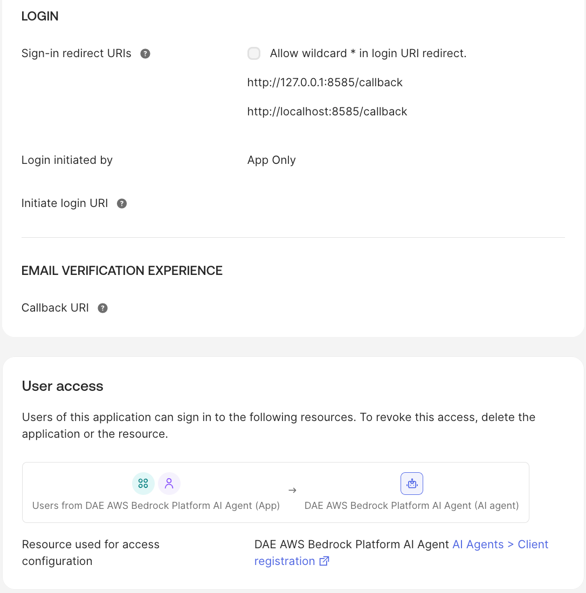

This is the standard app assignment as for any app in Okta.

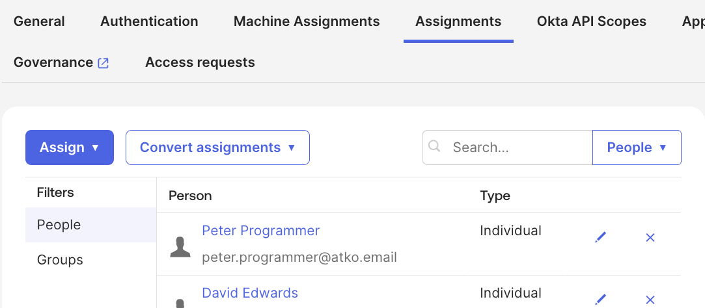

The client ID from this app is stored in the frontend app (environment variable) and used as part of the /authorize & /token calls to get the access token needed to connect to the gateway.

### Gateway Custom Authorisation Server
A new Agent Gateway object was created (see below) and that automatically created a new Custom Authorisation Server. This is the AS that the frontend app is calling for the /authorize and /token endpoints to generate the access token to allow the agent to call the Agent Gateway.

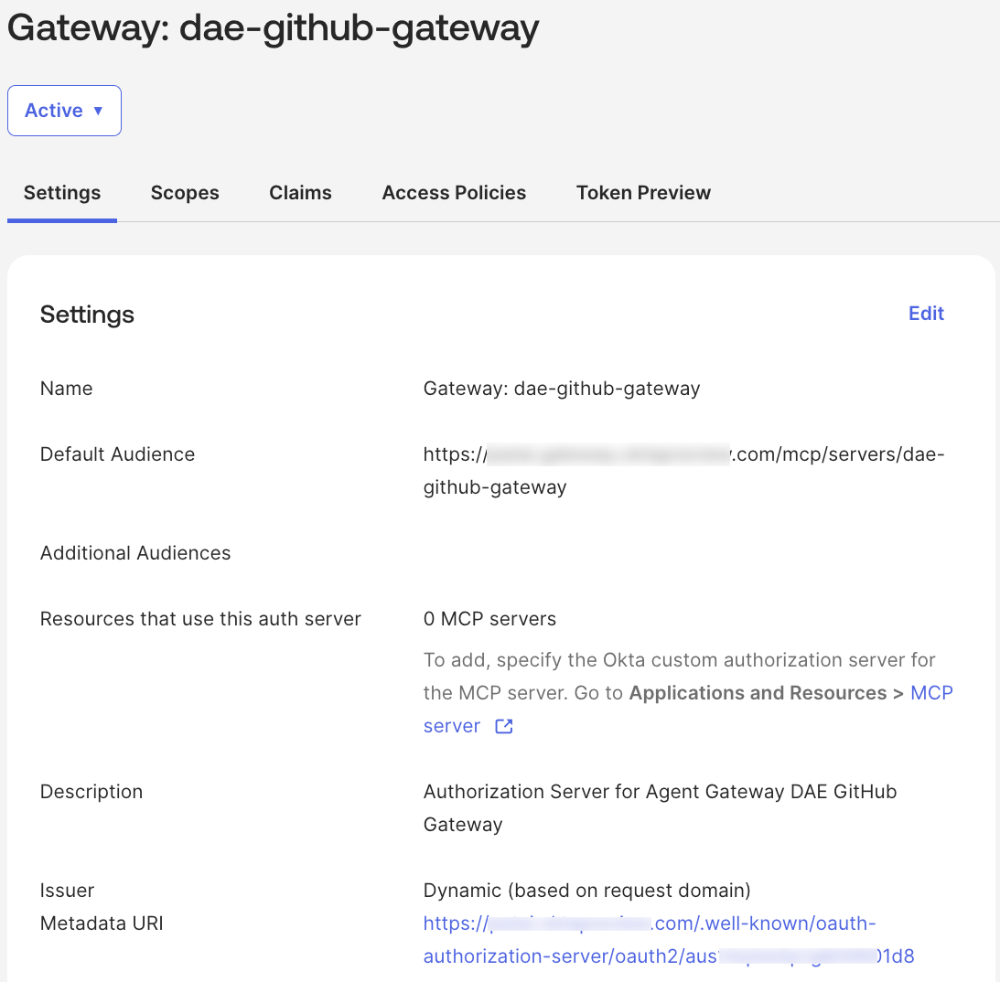

This is a standard custom authorisation server object in Okta. The only difference was that it was created by the Agent Gateway creation process.

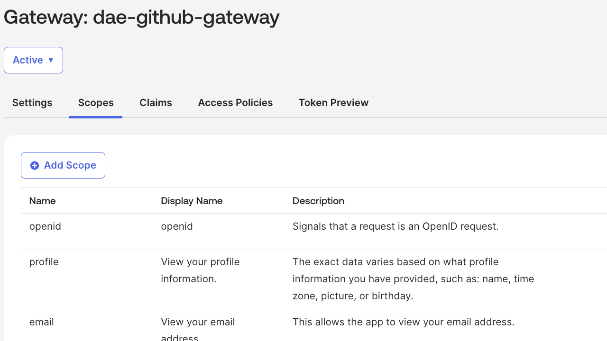

It is using the default scopes and claims. No custom scopes were required for this implementation.\
There is a single access policy.

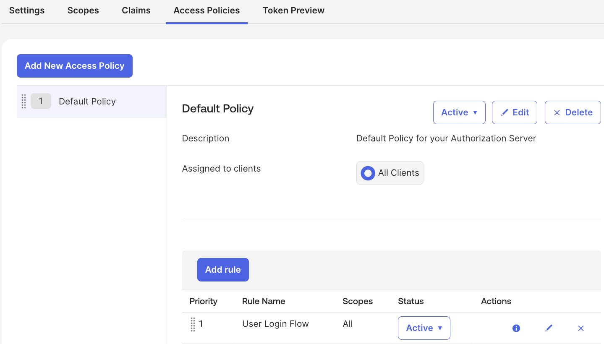

It contains a single rule for the user login flow.

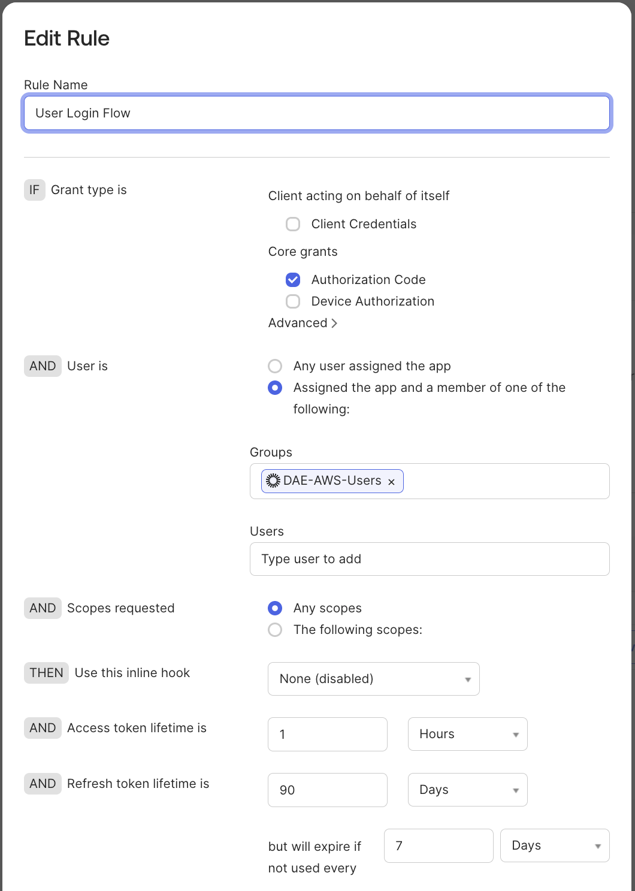

This rule is for Authorization Code grants for any users in a specific group (the demo apps user group) presenting any scopes. You could apply further fine-grained access control here, but it wasn’t needed for this implementation.

### Agent Gateway
The last component to cover is the Agent Gateway itself. It is how we define the policy of which agents can call the gateway and what downstream resources the gateway can call on their behalf.\
The Agent Gateway summary screen shows the gateway is connected to one AI Agent and one resource (the GitHub MCP Server).

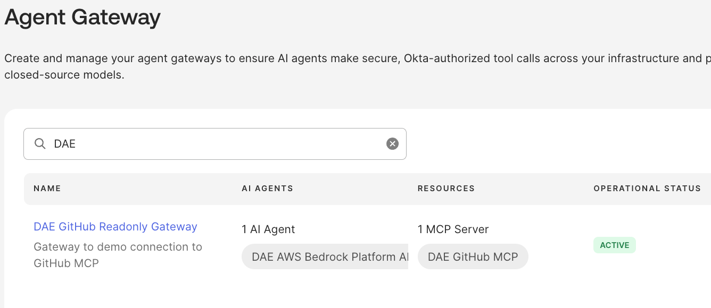

The gateway configuration shows the URL that the caller (in our case the Lambda function) must call. This is also the aud field in the access token passed across from the frontend app.

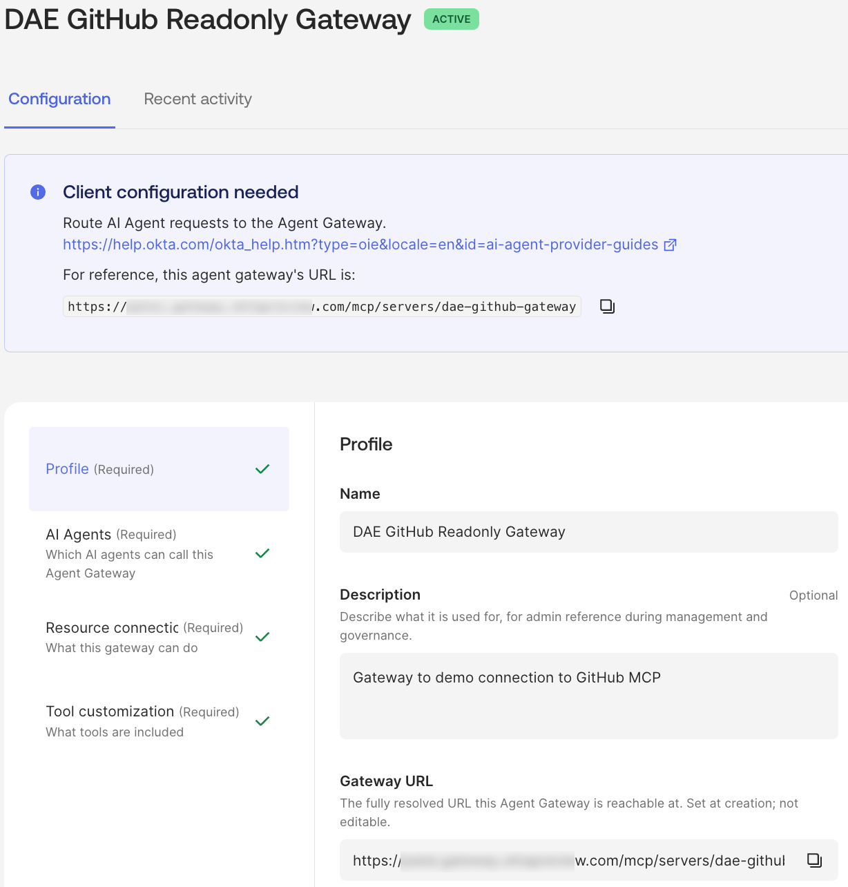

As with the AI Agent it has the standard profile tab. The next tab, AI Agents, define which AI Agents can call this Agent Gateway.

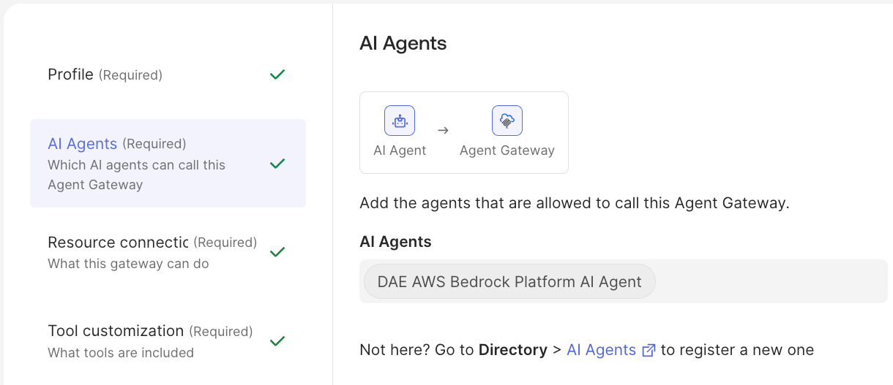

In our case it’s the single AI Agent object representing the whole Bedrock platform.\
The resource connections are what this gateway can call.

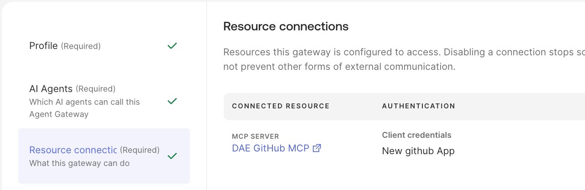

It is connected to our GitHub MCP Server definition\
With the gateway connected, you can define which of the complete toolset for this resource can be accessed by this gateway.

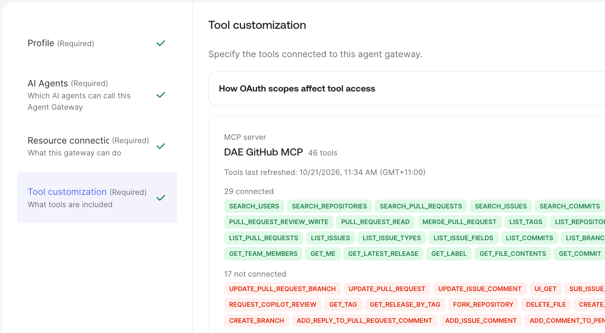

In this case 29 of the 46 possible tools were selected. This leaves out most of the update tools (such as creating branches, forking repositories and deleting files), but a couple of write-capable tools (such as merging a pull request) are still in the selected list. Updates are prevented by the read-only permissions on the GitHub App behind the MCP Server definition, not by this tool selection alone.\
This completes the Okta configuration.

## References

- [Set up imported AI agent token exchange](https://developer.okta.com/docs/guides/ai-agent-third-party-token-exchange/main/)
- [Configure an AI agent for Agent Gateway](https://developer.okta.com/docs/guides/ai-configure-agent-for-gateway/main/)
- [Configure an Agent Gateway](https://developer.okta.com/docs/guides/ai-configure-agent-gateway/main/)
- [Secure Amazon Bedrock Classic Agents with Okta](https://developer.okta.com/docs/guides/ai-agent-secure-aws-bedrock/main/)
- [Secure an Amazon Bedrock AgentCore agent](https://developer.okta.com/docs/guides/ai-agent-secure-amazon-bedrock/main/)
